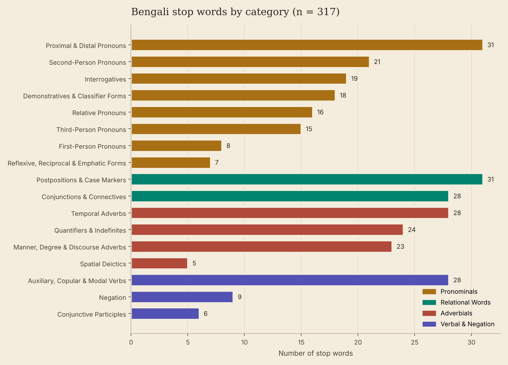
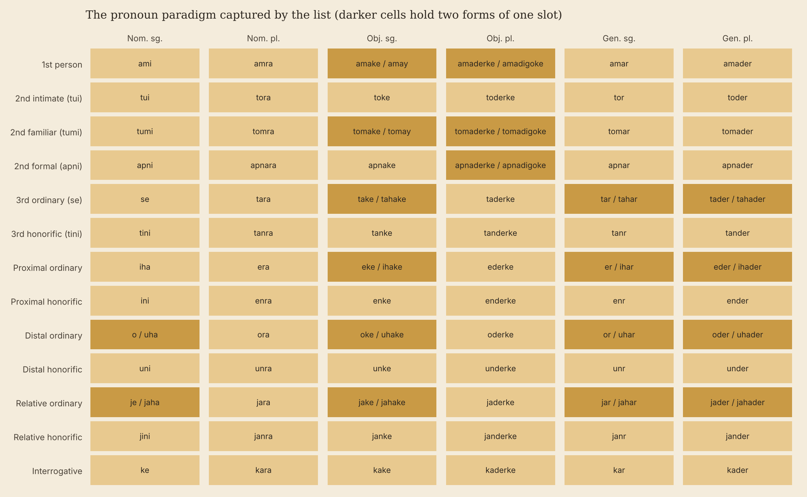

# The Words We Read Past: Bengali Stop Words for NLP

A categorised list of 317 Bengali stop words, with Bengali-script forms, English glosses and register labels, released as a Python module, as data files and as an interactive website.

**Website:** https://simantadh.github.io/Bengali_Stop_Words/

Simanta Nandi, MA Digital Humanities and Social Sciences, Indian Institute of Technology (Indian School of Mines) Dhanbad. Monsoon Semester 2026.



## What is here

Stop words are the small words that hold a sentence together: pronouns, postpositions, conjunctions, auxiliary verbs and negators. NLP pipelines usually remove them before counting, indexing or modelling a text. This project compiles 317 of them for Bengali and annotates every entry, so that the list can be checked, filtered by category and adapted to a research question rather than used blind.

| File | What it contains |
| --- | --- |
| `bengali_stopwords.py` | The list in the course format, the Bengali-script list, the categories, and two helper functions |
| `bengali_stopwords.txt` | Romanised stop words, one per line |
| `bengali_stopwords_bn.txt` | Bengali-script stop words, one per line |
| `bengali_stopwords.csv` | The full annotated table |
| `bengali_stopwords.json` | The table, the category scheme and the summary figures |
| the `fig*.png` files | Five figures for reports and slides |
| `stopword_data.py` | The master annotation table, the single source for everything else |
| `build_analysis.py` | Rebuilds the data files, figures and website data from the master table |
| `index.html`, `style.css`, `main.js`, `data.js`, `d3.min.js` | The project website, served by GitHub Pages |

## Using the list

`bengali_stopwords.py` needs nothing beyond the Python standard library. Place it next to your own script:

```python
from bengali_stopwords import bengali_stopwords, remove_stopwords, is_stopword

print(len(bengali_stopwords))   # 317

text = "আমি যখন প্রথমে এখানে এসেছিলাম, তখন শহরটা আমার কাছে একটু অচেনা ছিল"
print(remove_stopwords(text))   # ['এসেছিলাম', 'শহরটা', 'অচেনা']

print(is_stopword("tumi"), is_stopword("তুমি"))   # True True
```

To keep a category in the text, for example the pronouns of address when studying dialogue, build a custom list:

```python
from bengali_stopwords import bengali_stopwords, stopword_categories

keep = set(stopword_categories["Second-Person Pronouns"]) | set(stopword_categories["Negation"])
custom_list = [w for w in bengali_stopwords if w not in keep]
```

`remove_stopwords` normalises text to Unicode NFC first. Bengali letters such as য় and ড় can be stored in two ways that look identical, and without this step they fail to match.

Run `python bengali_stopwords.py` to print the counts for each category and a short demonstration.

## The categories

The 317 entries fall into 17 categories and four families.

| Family | Categories | Words |
| --- | --- | ---: |
| Pronominals | first, second and third person; proximal and distal; relative; interrogative; reflexive and emphatic; demonstratives and classifier forms | 135 |
| Relational words | conjunctions and connectives; postpositions and case markers | 59 |
| Adverbials | spatial deictics; temporal adverbs; quantifiers and indefinites; manner, degree and discourse adverbs | 80 |
| Verbal and negation | auxiliary, copular and modal verbs; conjunctive participles; negation | 43 |

## Main findings

1. Pronouns and their case forms make up 42.6 per cent of the list. Bengali marks person, number, case and three grades of politeness (tui, tumi, apni) on the pronoun, so the paradigm multiplies. Thirteen pronoun series across six case slots give 78 cells, and the list fills all of them.
2. The romanised list does not map one to one onto Bengali script. 317 entries resolve to 314 distinct Bengali words: onno and onnya are both অন্য, and jothto and jothesto are both যথেষ্ট. One entry, noba, could not be matched with confidence.
3. On a 49-token test passage the list removes 27 tokens (55.1 per cent). Words carrying classifiers or case endings, such as শহরটাকে, pass through, and a few frequent forms (একটা, গেল, মনে) are not on the list.
4. The correlative table (k-, j-, t-/s-, e-, o-) exposes gaps worth filling: kokhon, eto, oto and omon are missing.
5. Twenty-eight entries are literary Sadhu forms, almost all of them pronouns. They matter for digitised literature from before the mid twentieth century.



## Entries that need checking

Twelve entries carry a note in the data. Three should be checked against a dictionary before reuse: `noba` (no standard form found), `aposh` (possibly আপসে, 'among themselves') and `jothto` (probably a variant of `jothesto`). The list also writes `chilo` with one *h* but `chhilam` and `hochhilo` with two, so a text spelling `chhilo` will not be filtered.

## Rebuilding the data and figures

```bash
pip install matplotlib
python build_analysis.py
```

Edit `stopword_data.py` to add or change a word, then run the build script. It regenerates the CSV, JSON and text files, the figures in the `fig*.png` files and `data.js`, which the website reads. Then run `python generate_module.py` to regenerate `bengali_stopwords.py`, so the module and the data stay in step.

## Publishing the website

The site is plain HTML, CSS and JavaScript with no build step. In the repository settings, open **Pages**, choose **Deploy from a branch**, and select the `main` branch and the `/ (root)` folder. The site appears at https://simantadh.github.io/Bengali_Stop_Words/ within a few minutes. The empty `.nojekyll` file tells GitHub Pages to serve the files as they are.

## How to cite

> Nandi, S. (2026) *The words we read past: Bengali stop words for natural language processing*. Dhanbad: Department of Humanities and Social Sciences, Indian Institute of Technology (Indian School of Mines) Dhanbad. Available at: https://simantadh.github.io/Bengali_Stop_Words/

The website has a citation tool with APA, MLA, Chicago, Harvard, IEEE, Vancouver, BibTeX and RIS formats. GitHub also offers a citation from the `CITATION.cff` file through the **Cite this repository** button.

## Supervision

Project supervised by [Shanmugapriya T](https://shanmugapriya.com/) and [Sourav Ghosh](https://linktr.ee/sourav.dh.litcult), Department of Humanities and Social Sciences, IIT (ISM) Dhanbad.

## Contact

Simanta Nandi: [about.me/simantanandi](https://about.me/simantanandi), 25ma0013@iitism.ac.in. Corrections and suggestions for missing words are welcome as issues on this repository.

## Licence

This work is licensed under a [Creative Commons Attribution-NonCommercial 4.0 International Licence](https://creativecommons.org/licenses/by-nc/4.0/). You may share and adapt it for non-commercial purposes with credit to the author. See `LICENSE` for the full legal code. The bundled D3 library keeps its own ISC licence.
